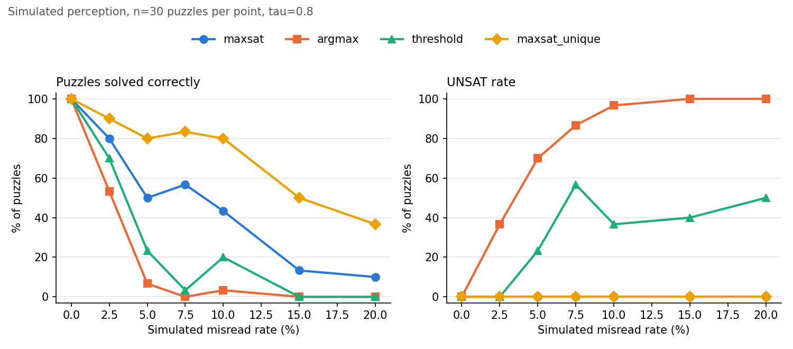

# Evaluation: simulated CNN, metrics, sweep

Code: [`src/sudoku_ns/eval/`](../src/sudoku_ns/eval/), [`scripts/sweep_simulated.py`](../scripts/sweep_simulated.py),
[`scripts/demo_reasoning.py`](../scripts/demo_reasoning.py). Tests: [`tests/test_eval.py`](../tests/test_eval.py).

## Why simulate the CNN?

The CNN only arrives in Week 2. To test the reasoning layer *now*, and at any error rate we choose,
`simulate_prob_grid(givens, error_rate, empty_miss_rate, hallucination_rate, ...)` produces a fake `ProbGrid` plus a
`CorruptionRecord` listing exactly which cells it broke.

| Corruption | Applies to | What the fake CNN does |
|---|---|---|
| misread | a given, prob `error_rate` | top class = a wrong digit, usually a look-alike (1↔7, 3↔8, 5↔6, ...) |
| missed | a given, prob `empty_miss_rate` | top class = empty |
| hallucinated | an empty cell, prob `hallucination_rate` | top class = a digit |

How it tries to look like a real CNN rather than "one-hot plus noise":

- correct cells: top probability drawn from 0.85-0.999, not always 1
- wrong cells: top probability from 0.40-0.90, so usually lower but overlapping (CNNs are overconfident when wrong)
- when wrong, the true class gets 40-80% of the remaining mass (it is usually the runner-up)
- the rest is spread with a Dirichlet, favouring look-alike classes

## Metrics (`metrics.py`)

"Before" = CNN argmax, "after" = what the solver decided the image shows (`read_givens`).

| Metric | Meaning |
|---|---|
| `solved_correct` | solution equals the true solution |
| `unsat` | solver gave up (only baselines can) |
| `cell_acc_before` / `cell_acc_after` | fraction of 81 cells read correctly, before / after reasoning |
| `n_misreads` | cells where the argmax was wrong (all three corruption types) |
| `misreads_corrected` | wrong before, right after |
| `correct_overridden` | right before, wrong after: the solver broke a correct reading |
| `solve_time_s` | time per puzzle |

## The sweep (`scripts/sweep_simulated.py`)

```
python scripts/sweep_simulated.py --n 30 --seed 0      # ~28 min on this laptop
python scripts/sweep_simulated.py --from-csv           # redraw plot/table only
```

For each misread rate e in {0, 2.5, 5, 7.5, 10, 15, 20}%: misread prob e, missed prob e/4, hallucination prob e/20.
Same 30 generated puzzles (seeds 0-29) at every rate. Four methods:

- `argmax`: trust the CNN fully, exact SAT solve
- `threshold`: drop digits with confidence < 0.8, then exact SAT solve
- `maxsat`: weighted MaxSAT (MAP reading consistent with *some* solution)
- `maxsat_unique`: MaxSAT with `require_unique=True` (MAP reading with a *unique* solution)

### Results (Week 1, n = 30 per point, real output)



% of puzzles solved correctly (UNSAT rate in brackets where non-zero):

| misread rate | argmax | threshold | maxsat | maxsat_unique |
|---|---|---|---|---|
| 0% | 100 | 100 | 100 | 100 |
| 2.5% | 53.3 (36.7 unsat) | 70.0 | 80.0 | **90.0** |
| 5% | 6.7 (70.0) | 23.3 (23.3) | 50.0 | **80.0** |
| 7.5% | 0.0 (86.7) | 3.3 (56.7) | 56.7 | **83.3** |
| 10% | 3.3 (96.7) | 20.0 (36.7) | 43.3 | **80.0** |
| 15% | 0.0 (100) | 0.0 (40.0) | 13.3 | **50.0** |
| 20% | 0.0 (100) | 0.0 (50.0) | 10.0 | **36.7** |

Misreads corrected (of all wrong cells) and correct readings broken:

| misread rate | wrong cells | maxsat fixed | maxsat_unique fixed | maxsat_unique broke |
|---|---|---|---|---|
| 2.5% | 28 | 15 | 21 | 0 |
| 5% | 72 | 39 | 54 | 3 |
| 10% | 100 | 61 | 76 | 1 |
| 20% | 237 | 122 | 146 | 5 |

Plain `maxsat` never broke a correct reading except 2 at 15%.

Mean time per puzzle: argmax/threshold ~4-5 ms; maxsat 56-104 ms; maxsat_unique 60 ms at 0%, 0.76 s at 5%,
1.7 s at 10%, **8.4 s at 20%**.

### What this shows

1. **argmax → SAT is brittle**: one clashing misread makes the puzzle UNSAT. At 5% misreads, 70% of puzzles fail
   this way.
2. **threshold helps a little** at low error but cannot fix confident misreads, and dropping digits leaves
   ambiguous puzzles.
3. **plain MaxSAT never fails outright** and fixes about half the wrong cells, but it often settles on a cheaper
   *ambiguous* reading (14 of 15 failures at 5%; see [reasoning.md](reasoning.md#require_unique-using-real-puzzles-have-one-solution)).
4. **require_unique** turns most of those into correct solves (50% → 80% at 5%), at a runtime cost that grows
   with noise.

The 0% → 2.5% drop for MaxSAT methods comes mostly from *missed* digits and misreads that do not clash with
anything: the rules cannot detect them.

### Caveats

- n = 30 per point: differences of ~10 points are within noise (e.g. maxsat at 5% vs 7.5% is not a real rise).
- The threshold `tau = 0.8` sits in the gap between the simulator's correct (0.85+) and wrong (≤0.9) confidence
  ranges, so it is tuned to the simulator. On real CNN output it must be chosen on the validation split.
- The simulator's realism is an assumption until we have the CNN. Re-run with real CNN outputs in Week 2/3.

## Demo (`scripts/demo_reasoning.py`)

```
python scripts/demo_reasoning.py --seed 0 --no-color
```

Prints the true givens, the corrupted CNN argmax (corrupted cells in brackets), the baseline result, the MaxSAT
reading with overrides explained, and whether the solution is right. With seed 0 and default settings it shows a
*failure* on purpose: three clashing misreads are fixed, but one non-clashing misread and one missed digit
remain, the reading is ambiguous (`unique=False`), and the solution is wrong.

With `--require-unique` the same seed *still* fails, which is worth understanding: the misread at (4, 1)
(true 5, CNN 6) clashes with nothing, so the true reading stays expensive. The cheapest *unique* reading instead
overrides a correct, confident 5 at (1, 3) (p = 0.91, "lower total cost"). Uniqueness is a strong prior, but it
cannot recover a misread that is consistent with the rules.
