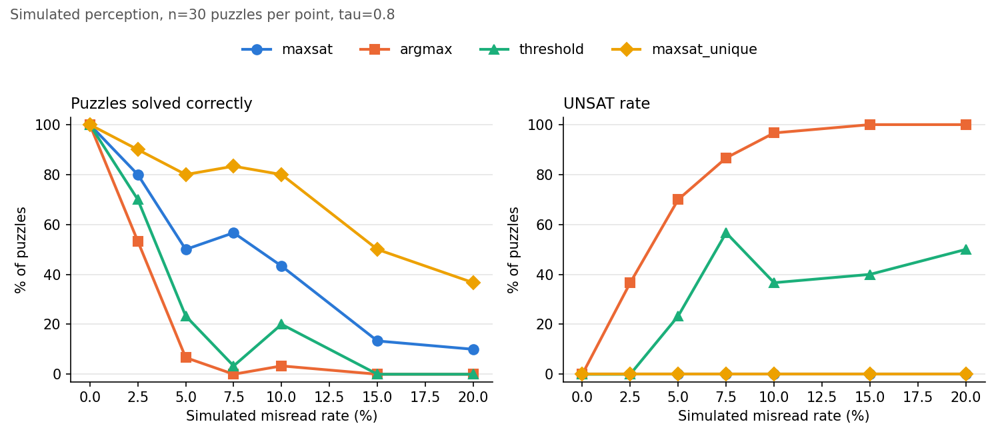

# Evaluation: simulated CNN, metrics, sweep

Code: [`src/sudoku_ns/eval/`](../src/sudoku_ns/eval/), [`scripts/sweep_simulated.py`](../scripts/sweep_simulated.py),
[`scripts/demo_reasoning.py`](../scripts/demo_reasoning.py). Tests: [`tests/test_eval.py`](../tests/test_eval.py).

## Why simulate the CNN?

The CNN only arrives in Week 2. To test the reasoning layer *now*, and at any error rate we choose,
`simulate_prob_grid(givens, error_rate, empty_miss_rate, hallucination_rate, ...)` produces a fake `ProbGrid` plus a
`CorruptionRecord` listing exactly which cells it broke.

| Corruption | Applies to | What the fake CNN does |
|---|---|---|
| misread | a given, prob `error_rate` | top class = a wrong digit, usually a look-alike (1↔7, 3↔8, 5↔6, ...) |
| missed | a given, prob `empty_miss_rate` | top class = empty |
| hallucinated | an empty cell, prob `hallucination_rate` | top class = a digit |

How it tries to look like a real CNN rather than "one-hot plus noise":

- correct cells: top probability drawn from 0.85-0.999, not always 1
- wrong cells: top probability from 0.40-0.90, so usually lower but overlapping (CNNs are overconfident when wrong)
- when wrong, the true class gets 40-80% of the remaining mass (it is usually the runner-up)
- the rest is spread with a Dirichlet, favouring look-alike classes

## Metrics (`metrics.py`)

"Before" = CNN argmax, "after" = what the solver decided the image shows (`read_givens`).

| Metric | Meaning |
|---|---|
| `solved_correct` | solution equals the true solution |
| `unsat` | solver gave up (only baselines can) |
| `cell_acc_before` / `cell_acc_after` | fraction of 81 cells read correctly, before / after reasoning |
| `n_misreads` | cells where the argmax was wrong (all three corruption types) |
| `misreads_corrected` | wrong before, right after |
| `correct_overridden` | right before, wrong after: the solver broke a correct reading |
| `solve_time_s` | time per puzzle |

## The sweep (`scripts/sweep_simulated.py`)

```
python scripts/sweep_simulated.py --n 30 --seed 0      # ~28 min on this laptop
python scripts/sweep_simulated.py --from-csv           # redraw plot/table only
```

For each misread rate e in {0, 2.5, 5, 7.5, 10, 15, 20}%: misread prob e, missed prob e/4, hallucination prob e/20.
Same 30 generated puzzles (seeds 0-29) at every rate. Four methods:

- `argmax`: trust the CNN fully, exact SAT solve
- `threshold`: drop digits with confidence < 0.8, then exact SAT solve
- `maxsat`: weighted MaxSAT (MAP reading consistent with *some* solution)
- `maxsat_unique`: MaxSAT with `require_unique=True` (MAP reading with a *unique* solution)

### Results (Week 1, n = 30 per point, real output)



% of puzzles solved correctly (UNSAT rate in brackets where non-zero):

| misread rate | argmax | threshold | maxsat | maxsat_unique |
|---|---|---|---|---|
| 0% | 100 | 100 | 100 | 100 |
| 2.5% | 53.3 (36.7 unsat) | 70.0 | 80.0 | **90.0** |
| 5% | 6.7 (70.0) | 23.3 (23.3) | 50.0 | **80.0** |
| 7.5% | 0.0 (86.7) | 3.3 (56.7) | 56.7 | **83.3** |
| 10% | 3.3 (96.7) | 20.0 (36.7) | 43.3 | **80.0** |
| 15% | 0.0 (100) | 0.0 (40.0) | 13.3 | **50.0** |
| 20% | 0.0 (100) | 0.0 (50.0) | 10.0 | **36.7** |

Misreads corrected (of all wrong cells) and correct readings broken:

| misread rate | wrong cells | maxsat fixed | maxsat_unique fixed | maxsat_unique broke |
|---|---|---|---|---|
| 2.5% | 28 | 15 | 21 | 0 |
| 5% | 72 | 39 | 54 | 3 |
| 10% | 100 | 61 | 76 | 1 |
| 20% | 237 | 122 | 146 | 5 |

Plain `maxsat` never broke a correct reading except 2 at 15%.

Mean time per puzzle: argmax/threshold ~4-5 ms; maxsat 56-104 ms; maxsat_unique 60 ms at 0%, 0.76 s at 5%,
1.7 s at 10%, **8.4 s at 20%**.

### What this shows

1. **argmax → SAT is brittle**: one clashing misread makes the puzzle UNSAT. At 5% misreads, 70% of puzzles fail
   this way.
2. **threshold helps a little** at low error but cannot fix confident misreads, and dropping digits leaves
   ambiguous puzzles.
3. **plain MaxSAT never fails outright** and fixes about half the wrong cells, but it often settles on a cheaper
   *ambiguous* reading (14 of 15 failures at 5%; see [reasoning.md](reasoning.md#require_unique-using-real-puzzles-have-one-solution)).
4. **require_unique** turns most of those into correct solves (50% → 80% at 5%), at a runtime cost that grows
   with noise.

The 0% → 2.5% drop for MaxSAT methods comes mostly from *missed* digits and misreads that do not clash with
anything: the rules cannot detect them.

### Caveats

- n = 30 per point: differences of ~10 points are within noise (e.g. maxsat at 5% vs 7.5% is not a real rise).
- The threshold `tau = 0.8` sits in the gap between the simulator's correct (0.85+) and wrong (≤0.9) confidence
  ranges, so it is tuned to the simulator. On real CNN output it must be chosen on the validation split.
- The simulator's realism is an assumption until we have the CNN. Re-run with real CNN outputs in Week 2/3.

## Week 2: end to end with the real CNN (`scripts/run_e2e.py`)

```
python scripts/run_e2e.py --config configs/e2e_test_clean_cnn.json
python scripts/summarize_e2e.py outputs/e2e/e2e_test_clean_cnn.csv            # --markdown for docs
```

Every image goes through **real** grid detection → cell extraction → perceiver → each method. Vision and
perception run once per image, so all methods see exactly the same probabilities. One CSV row per image × method.
The run is resumable, and `failure_stage` records the *first* stage that went wrong:

| stage | meaning |
|---|---|
| vision | grid not found, or mean corner error ≥ 5 px |
| perception | vision fine, the CNN argmax misread ≥ 1 cell, and this method did not repair it |
| reasoning | vision and the CNN argmax were entirely right, and the method still failed |

Methods: `maxsat_weighted` (MAP), `maxsat_unique` (MAP among readings with a unique solution),
`maxsat_unweighted` (ablation: rules, no confidences), `argmax_then_sat`, `threshold_then_sat` (tau chosen on val).

### Choosing tau for the threshold baseline (val only)

`scripts/tune_threshold.py` on the 300 val renders: tau = 0.5-0.9 all solve 99.7% (one failure), 0.95 → 99.3%,
0.99 → 95.7%, 0.999 → 82.0%. The val set is nearly perfect, so it cannot separate 0.5 from 0.9. The tie rule fixed
in the script beforehand (the smaller tau) gives **tau = 0.5**, which makes the baseline almost identical to
argmax. A **sensitivity check** on test, *reported only and not used to choose*: tau = 0.8 → 73.0% and tau = 0.9 →
71.0% solved, both below tau = 0.5's 74.5%. So the choice did not handicap the baseline.

### Results: `test_clean` (200 renders, held-out test fonts, trained CNN `cnn_v1`, T = 1.10)

Real output. Cell accuracy is over all 81 cells of each image, before (CNN argmax) and after (the method's reading).

| method | solved correctly | UNSAT | cell acc before → after | misreads fixed | correct reads broken | median / p95 time |
|---|---|---|---|---|---|---|
| **maxsat_unique** | **98.0%** | 0% | 99.26 → **99.98%** | 116 / 120 | 0 | 62 / 231 ms |
| **maxsat_weighted** | **89.5%** | 0% | 99.26 → 99.81% | 93 / 120 | 4 | 55 / 120 ms |
| maxsat_unweighted | 77.5% | 0% | 99.26 → 99.07% | 0 / 120 | 30 | 38 / 104 ms |
| argmax_then_sat | 74.5% | 23.5% | 99.26% (unchanged) | 0 | 0 | 7 / 11 ms |
| threshold_then_sat (tau 0.5) | 74.5% | 23.5% | 99.26% (unchanged) | 0 | 0 | 7 / 11 ms |

Failure stage: **vision 0** for every method (all 200 grids found within 5 px); **reasoning 0** for every method.
Every failure starts with a CNN misread. 51 of the 200 images have at least one misread cell, and **all 120
misread cells are 5→6 or 9→8 in the Space Mono font** ([perception.md](perception.md#results-run-cnn_v1-real-output)).
On those 51 images: maxsat_unique solves 47, maxsat_weighted 30, maxsat_unweighted 6, argmax and threshold 0
(47 UNSAT, 4 wrong).

What this shows:

1. **The neurosymbolic step pays off on real CNN output.** With one font the CNN has never seen, argmax → SAT
   fails on a quarter of the puzzles. Weighted MaxSAT fixes 93 of the 120 misread cells, and with the uniqueness
   prior 116, solving 98% of the puzzles.
2. **Confidences matter** (weighted vs unweighted, 89.5% vs 77.5%). The unweighted ablation can only *drop* a
   clashing digit; with equal weights it often drops the *correct* one of the two (30 correct readings broken),
   and it can never read the right digit back in (0 fixed). The weighted solver reads the CNN's runner-up back in.
3. **The remaining failures are misreads that break no rule.** Example: `test_clean/00097`. The pipeline
   (`python -m sudoku_ns.pipeline ... --out vis.png`) fixes 5 of its 6 misreads, each with a correct unsat-core
   reason. But the 6 read at (3, 1) (truly 5, p = 0.95) clashes with nothing, and the resulting puzzle even has a
   **unique** (wrong) solution. No Sudoku rule can catch that. For maxsat_weighted, 3 of the 21 failures are
   "unique but wrong" like this, and for maxsat_unique all 4 are.
4. Runtime is not an issue at this error level: maxsat_unique has a p95 of 231 ms and a maximum of 0.82 s.

### Link to Week 1: real vision + simulated CNN (`configs/e2e_test_clean_oracle.json`)

The same 200 images and real grid detection, but the Week 1 simulator (5% misreads, 1.25% missed, 0.25%
hallucinated) as the perceiver:

| method | solved correctly | UNSAT | misreads fixed | broken |
|---|---|---|---|---|
| maxsat_weighted | 59.5% | 0% | 279 / 435 | 5 |
| threshold_then_sat (tau 0.8) | 26.5% | 27.5% | 21 / 435 | 0 |
| maxsat_unweighted | 23.0% | 0% | 17 / 435 | 84 |
| argmax_then_sat | 14.0% | 77.5% | 0 / 435 | 0 |

These agree with the Week 1 sweep at 5% (n = 30: maxsat 50.0%, threshold 23.3%, argmax 6.7%). The simulator's
errors (scattered over all digits, about 2 per puzzle) are much harsher than the real CNN's (one font, one
confusion), which is why the real-CNN numbers above are higher.

### Preliminary: small noisy test sets (`configs/e2e_test_noise_cnn.json`)

**Preliminary: n = 50 images per row**, so one image is 2 points and differences under about 10 points are noise.
Each set is test_clean images 0-49 with one noise type applied (paired with the clean images). The full sweep
(200 images per point, more severities) is a Week 3 issue.

% of images solved correctly (real output):

| dataset | maxsat_weighted | maxsat_unweighted | argmax_then_sat | threshold_then_sat | maxsat_unique |
|---|---|---|---|---|---|
| *same 50 images, clean* | *88%* | *82%* | *76%* | *76%* | *96%* |
| blur 0.25 (sigma 0.75 px) | 80% | 70% | 68% | 68% | 94% |
| blur 0.5 (sigma 1.5 px) | 74% | 64% | 64% | 64% | 84% |
| blur 1.0 (sigma 3 px) | 78% | 68% | 68% | 70% | 86% |
| gaussian_noise 0.25 | 90% | 86% | 78% | 78% | 96% |
| gaussian_noise 0.5 | 88% | 76% | 72% | 72% | 96% |
| gaussian_noise 1.0 (sigma 25) | 92% | 82% | 76% | 76% | 98% |
| jpeg 0.25 | 88% | 82% | 78% | 78% | 96% |
| jpeg 0.5 | 92% | 88% | 84% | 84% | 98% |
| jpeg 1.0 (quality 10) | 94% | 74% | 70% | 70% | 100% |
| lighting 0.25 | 88% | 80% | 74% | 74% | 96% |
| lighting 0.5 | 86% | 76% | 74% | 74% | 98% |
| lighting 1.0 | 90% | 78% | 74% | 74% | 96% |
| rotate 0.25 (3.75°) | 84% | 78% | 70% | 70% | 96% |
| rotate 0.5 (7.5°) | 80% | 74% | 66% | 66% | 96% |
| rotate 1.0 (15°) | 86% | 78% | 72% | 72% | 96% |

For every set: **vision failures 0**, and every failure is at the perception stage.

CNN cell accuracy before reasoning (mean over the 50 images): blur 98.74 / 97.09 / 97.48%; every other set
99.2-99.6% (clean: 99.26% on all 200).

Reading it carefully:

- The method ranking is the same in all 15 sets: maxsat_unique > maxsat_weighted > unweighted ≥ argmax ≈ threshold.
- **Blur is the only degradation that clearly hurts** (cell accuracy drops to about 97%, and maxsat_unique falls
  to 84-86%). Noise, JPEG and lighting do not hurt at these levels. The 40% noisy training renders contain all of
  these, and the cell cleaning normalises brightness.
- Severity is **not monotonic** here (blur 0.5 is worse than blur 1.0; gaussian_noise 1.0 is better than 0.5).
  With n = 50 that is within noise. Do not read trends from this table; the Week 3 sweep is for that.
- Runtime tail: maxsat_unique has a median of 64 ms and a p95 of 633 ms, but one image (blur_0.5/00037, 12 misread
  cells) took **134 s** and still ended with an ambiguous reading. Two others took 61 s and 58 s. A time limit, or
  fewer rounds, is needed before the demo.

## Demo (`scripts/demo_reasoning.py`)

```
python scripts/demo_reasoning.py --seed 0 --no-color
```

Prints the true givens, the corrupted CNN argmax (corrupted cells in brackets), the baseline result, the MaxSAT
reading with overrides explained, and whether the solution is right. With seed 0 and default settings it shows a
*failure* on purpose: three clashing misreads are fixed, but one non-clashing misread and one missed digit
remain, the reading is ambiguous (`unique=False`), and the solution is wrong.

With `--require-unique` the same seed *still* fails, which is worth understanding: the misread at (4, 1)
(true 5, CNN 6) clashes with nothing, so the true reading stays expensive. The cheapest *unique* reading instead
overrides a correct, confident 5 at (1, 3) (p = 0.91, "lower total cost"). Uniqueness is a strong prior, but it
cannot recover a misread that is consistent with the rules.
